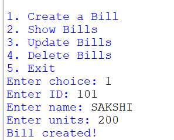
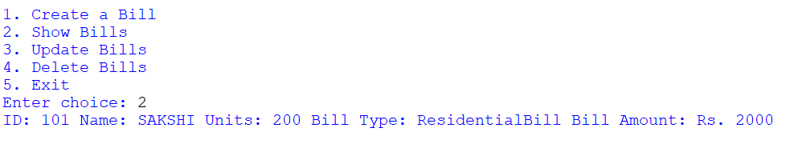
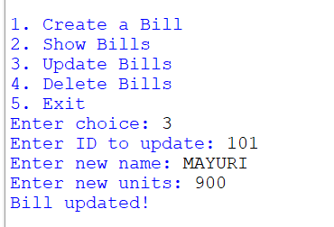
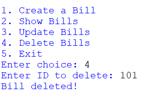

# ⚡ Electricity Bill Management System Using Python OOP

## 📌 About the Project

The Electricity Bill Management System is a menu-driven Python application developed using Object-Oriented Programming (OOP) concepts.

It helps manage electricity billing records by allowing users to create, view, update, and delete electricity bills. The system calculates electricity charges based on the number of units consumed and automatically assigns Residential or Commercial bill types.

The application uses a simple command-line interface to perform billing operations efficiently.

## 🛠️ Technologies Used

- Python 3
- Object-Oriented Programming (OOP)
- ABC Module
- Abstract Classes
- Inheritance
- Encapsulation
- Dictionary for Data Storage

## ✨ Features

- **Create a Bill:** Add new electricity billing records with ID, customer name, and units consumed.
- **Show Bills:** Display all electricity billing records with customer details and bill amounts.
- **Update Bills:** Modify existing customer names and electricity units.
- **Delete Bills:** Remove electricity billing records using their unique ID.
- **Bill Calculation:** Automatically calculate electricity charges based on units consumed.
- **Bill Type Classification:** Automatically assign Residential or Commercial bill types.
- **Duplicate ID Validation:** Prevent duplicate bill IDs.
- **Units Validation:** Prevent negative electricity units.
- **Dynamic Bill Calculation:** Calculate the updated bill amount whenever billing information changes.

## ⚙️ Working Principle

1. The program displays a menu with five options: Create a Bill, Show Bills, Update Bills, Delete Bills, and Exit.
2. The user selects an option according to the required operation.
3. When creating a bill, the system accepts the customer ID, name, and electricity units.
4. The system checks for duplicate IDs and validates electricity units.
5. Based on electricity consumption, the system automatically assigns a Residential or Commercial bill type.
6. The electricity bill amount is calculated according to the unit-based rates.
7. Users can view, update, and delete existing billing records using their unique IDs.
8. The program continues running until the user selects the Exit option.

## 💰 Electricity Bill Calculation

The electricity bill amount is calculated according to the following unit-based rates:

| Electricity Units | Rate per Unit |
|---|---:|
| Up to 100 | ₹5 |
| 101–300 | ₹10 |
| 301–500 | ₹15 |
| Above 500 | ₹18 |

**Formula:**

Bill Amount = Total Units × Applicable Rate

**Example:**

If a customer consumes 200 units:

200 × ₹10 = ₹2,000

## 🏠 Bill Type Classification

The system automatically assigns the bill type based on electricity consumption.

| Electricity Units | Bill Type |
|---|---|
| Up to 300 units | ResidentialBill |
| Above 300 units | CommercialBill |

## 📚 OOP Concepts Implemented

**1. Abstraction**
- Uses an abstract `Bill` class.
- Defines an abstract `calculate()` method.
- Provides a common structure for different bill types.

**2. Inheritance**
- `ResidentialBill` inherits from the `Bill` class.
- `CommercialBill` inherits from the `Bill` class.
- Both classes implement the `calculate()` method.

**3. Encapsulation**
- Stores electricity units in a private attribute `__units`.
- Uses the `get_units()` method to access the private units attribute.

**4. Polymorphism**
- Both `ResidentialBill` and `CommercialBill` implement the `calculate()` method.
- The appropriate calculation method is called through the bill object.

## 📸 Project Screenshots

### 1. Create a Bill

Demonstrates creating a new electricity bill by entering customer ID, name, and electricity units.



### 2. Show Bills

Displays electricity billing records with customer details, units consumed, bill type, and calculated bill amount.



### 3. Update Bills

Demonstrates updating an existing customer's name and electricity consumption units.



### 4. Delete Bills

Demonstrates deleting an electricity billing record using the customer ID.



## 📂 Project Structure

```text
Electricity-Bill-Management-System/
│
├── BILL.py
├── CREATE-BILL.png
├── SHOW-BILL.png
├── UPDATE-BILL.png
├── DELETE-BILL.png
└── README.md
```

## 🚀 How to Run the Project

**Step 1:** Install Python 3 on your computer.

**Step 2:** Clone this repository.

```bash
git clone https://github.com/YOUR-USERNAME/Electricity-Bill-Management-System.git
```

**Step 3:** Open the project folder.

```bash
cd Electricity-Bill-Management-System
```

**Step 4:** Run the Python program.

```bash
python BILL.py
```

**Step 5:** Select an option from the menu to perform electricity billing operations.

## 📋 Application Menu

```text
1. Create a Bill
2. Show Bills
3. Update Bills
4. Delete Bills
5. Exit
```

## ⚠️ Limitations

- Billing records are stored temporarily in a Python dictionary.
- Records are not permanently saved after the program exits.
- The application currently runs through a command-line interface.
- The system does not currently generate downloadable electricity bills.

## 🎯 Learning Outcomes

- Understanding Python Object-Oriented Programming concepts.
- Implementing abstraction and inheritance using abstract classes.
- Understanding encapsulation through private attributes.
- Implementing polymorphism using method overriding.
- Performing CRUD operations in Python.
- Applying input validation and duplicate ID checking.
- Developing menu-driven Python applications.
- Implementing automatic electricity bill calculations.

## 👩‍💻 Author

**Sakshi Shimpi**

- GitHub: [sakshishimpi03](https://github.com/sakshishimpi03)
- LinkedIn: [sakshi-shimpi](https://linkedin.com/in/sakshi-shimpi)

---
